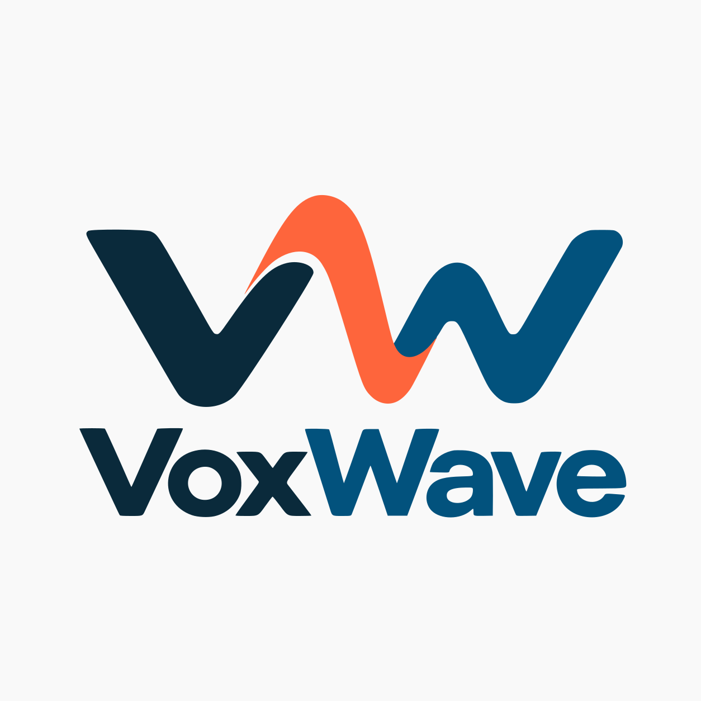

# VoxWave
Proyecto para Creative Shock: exploración de screening de Parkinson mediante voz, con funcionamiento offline como requisito prioritario.

Estado: estructura de trabajo inicial. No hay todavía aplicación, modelo entrenado ni validación clínica.

Este repositorio reúne tanto el video como el desarrollo. Los materiales previos del logo y su animación están en [video/assets/logo](video/assets/logo/README.md), y sus scripts en [video/tools](video/tools/README.md). A partir de ahora, guardar el trabajo nuevo dentro de este repositorio para poder compartirlo mediante GitHub.

## Áreas
- `video/`: guion, storyboard, prompts Seedance e imagen, referencias, assets y edición.
- `platform/`: frontend, mobile, backend, API y análisis de voz.
- `hardware/`: exploración de dispositivo; hardware opcional, sin componentes elegidos.
- `docs/`: contexto, estado, decisiones, hoja de ruta, investigación y arquitectura.
- `datasets/`: únicamente documentación de procedencia y permisos; nunca datos.
- `experiments/`: código y notas reproducibles, sin datos sensibles.

Empieza por [contexto](docs/PROJECT_CONTEXT.md), [estado](docs/STATUS.md) y [configuración de Codex](docs/CODEX_SETUP.md).
Las instrucciones para agentes están en [AGENTS.md](AGENTS.md).

## Verificación
Desde la raíz: `python scripts/check_repository.py`.
No requiere dependencias externas. Comprueba archivos versionados o preparados para commit, estructura y exclusiones; no certifica ausencia de datos sensibles en el contenido.

Los audios clínicos, datasets restringidos, credenciales, pesos y renders pesados quedan fuera de Git. Revisar siempre el contenido antes de subirlo.
